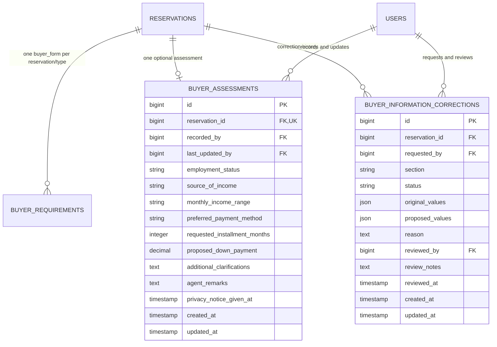

# Phase 7 refinement: contact information and Agent assessment

Implemented October 11, 2026 (Asia/Manila), following the supplied additional Phase 7 refinement. The existing Windows workspace, Phase 6 conversations, Agent-to-Lot assignments, Phase 7 reservation workflow, authentication, SVG layout, Blade/Tailwind/vanilla JavaScript stack, and Supabase PostgreSQL connection were inspected before changes.

## Contact information

The existing `buyer_requirements` row with `requirement_type = buyer_form` remains the Buyer's contact record. Its `contact_number`, `address`, and `notes` columns are reused; no existing migration or contact data was replaced. The UI now calls this section **Buyer's Contact Information**, and `notes` is labeled **Additional contact details (optional)**.

Before submission, the Buyer sees the form. After a successful submission, only the summary is displayed. While Pending Review, **Edit Information** opens the prefilled form through a normal GET request. **Save Changes** updates the same record; **Cancel** returns to the summary without a write. Approved, rejected, and cancelled reservations do not permit normal contact editing. The backend checks ownership and the current reservation status inside the write transaction.

Existing contact records are displayed without automatically reclassifying or rewriting their previous notes. Buyers should keep future submissions limited to contact details.

## Assessment and permissions

A separate `buyer_assessments` record belongs to one reservation. This separates Buyer-submitted contact details from Agent-recorded information and permits stricter access to financial details and internal remarks.

All suggested business fields are optional: employment status, source of income, approximate monthly income range, preferred payment method, requested installment months, proposed down payment, additional requirements/clarifications, and Agent remarks. SGRE still needs to confirm its final collection requirements. Field sizes and numeric bounds match storage limits; they do not define financial eligibility or approved transaction terms.

The assigned Agent can save/update only while Pending Review. Reservation, inquiry, and current lot assignment must all identify that Agent. The Agent must explicitly confirm explaining the privacy notice and correction process before saving. The first notice date and recording Agent are preserved; the latest editor and update date are also shown.

For Spot Cash or an unspecified payment preference, installment duration and down payment are hidden/disabled in the form and excluded from validation/storage. Switching away from Installment clears previously recorded installment values. Without JavaScript, the Agent can save an Installment preference first, then enter optional installment details on the refreshed form.

| User | Assessment access |
| --- | --- |
| Assigned Agent | Read facts and internal remarks; edit only while Pending Review. |
| Supervising Unit Manager | Read facts and internal remarks; approve/reject requested factual corrections. |
| Reservation's Buyer | Read facts recorded about them and request factual corrections; cannot directly edit the assessment. Internal remarks are not selected from the database for the Buyer view. |
| Other Buyers/Agents/Unit Managers | No access to unrelated records. |
| Secretary/Admin | Existing reservation/contact oversight remains; no assessment, financial assessment, internal remarks, or correction-history access. |
| Field Planner/Cashier | No access to this reservation-information workflow. |

Internal remarks are also hidden from default assessment serialization. Assessment data is not added to inventory, conversation messages, dashboard cards, or notification payloads. Notifications contain only a reservation reference and generic activity description.

The Unit Manager review page shows the property/reservation, Buyer's contact details, recorded assessment, recording Agent, update provenance, and explicit missing-value labels. **No assessment is required for reservation approval**, because the fields have not been confirmed as mandatory. The existing requirement that contact information must be submitted before approval remains intact. Saving assessments and resolving corrections never changes lot or reservation status.

## Correction process

Normal editing stays locked after approval. Factual changes use separate, recorded correction requests:

1. The Buyer may request correction of their Agent-recorded facts. Once normal contact editing is locked, they may also request contact corrections. The assigned Agent may request factual assessment corrections when normal editing is locked.
2. Each request identifies a section, one factual field, the proposed value, and a reason. Internal Agent remarks and protected metadata cannot be submitted as Buyer corrections. Agents cannot request contact changes on a Buyer's behalf.
3. The current factual snapshot and proposed values are stored; the original record is unchanged. Only one pending request per reservation/section is allowed, enforced by a database partial unique index.
4. Only the supervising Unit Manager may approve or reject. Decision notes are required. Approval applies the recorded proposed values and preserves the audit record, requester, original values, reviewer, and review date. An assessment retains its original recording Agent; the Unit Manager becomes its latest editor. Corrected contact records retain the original Buyer and submission date.
5. If facts changed after a request was made, approval is blocked to prevent overwriting newer information. The Manager can reject it and ask for a current request. Reviewed requests cannot be applied twice.

Payment-preference corrections that remove installment terms include the cleared duration/down payment in the proposed change and audit record. Requests and decisions are visible to the Buyer, assigned Agent, and supervising Unit Manager; the forms explicitly ask Agents to keep internal remarks out of correction reasons. Corrections are available for retained reservation history as well as approved reservations, without reopening or changing those reservations.

## Schema and relationships

The design was proposed in the conversation before adding its migration. Existing `buyer_requirements` is reused for contact information; the two new tables normalize assessment permissions and retain correction history.



Added `database/migrations/2026_10_11_080000_create_buyer_assessments_and_information_corrections.php`. Assessment facts/remarks are nullable; authorship and the notice timestamp are required. Correction review metadata is nullable until a decision. Foreign keys preserve related reservation/user identity; the unique assessment reservation ID prevents duplicate assessments. The pending-correction uniqueness index is compatible with PostgreSQL and SQLite. No dependencies were added, and no existing tables, columns, connection settings, or migrations were recreated.

## Changed files

Created:

- `app/Models/BuyerAssessment.php`
- `app/Models/BuyerInformationCorrection.php`
- `app/Policies/ReservationPolicy.php`
- `app/Support/BuyerAssessmentData.php`
- `app/Support/LockedReservationInformation.php`
- `app/Http/Requests/SaveBuyerAssessmentRequest.php`
- `app/Http/Controllers/BuyerAssessmentController.php`
- `app/Http/Controllers/BuyerInformationCorrectionController.php`
- `database/migrations/2026_10_11_080000_create_buyer_assessments_and_information_corrections.php`
- `resources/views/components/textarea-field.blade.php`
- `resources/views/components/form-errors.blade.php`
- `resources/views/components/information-value.blade.php`
- `resources/views/components/correction-form.blade.php`
- `resources/views/reservations/contact.blade.php`
- `resources/views/reservations/assessment.blade.php`
- `resources/views/reservations/corrections.blade.php`
- `resources/js/reservations.js`
- `tests/Feature/BuyerInformationWorkflowTest.php`
- `docs/phase7-buyer-information.md`

Modified:

- `app/Models/Reservation.php`: assessment/correction relationships.
- `app/Http/Controllers/ReservationController.php`: scoped private assessment loading, correction history, contact validation/edit authorization, and contact labels. Existing reservation creation/review/cancellation behavior is retained.
- `routes/web.php`: assessment and correction endpoints under authentication, session validation, email verification, and role restrictions.
- `resources/views/reservations/show.blade.php`: shared contact/assessment/correction sections; Buyer pages no longer show internal reservation Agent notes.
- `resources/views/components/form-field.blade.php`, `resources/views/components/select-field.blade.php`: optional named validation bags, retaining existing defaults.
- `resources/js/app.js`: load conditional installment-field behavior.
- `README.md`, `docs/phase7-reservations.md`: link the refinement and update current implementation status.
- `public/build/manifest.json` and generated CSS/JS assets: rebuilt production output.

## Verification and setup

- Existing baseline suite: **128 tests passed, 1,221 assertions** after connecting the refined UI.
- Full suite including **30 new refinement cases**: **158 tests passed, 1,558 assertions**.
- Tests cover summary/edit/cancel navigation, same-record contact updates, ownership, optional fields, privacy attestation, author preservation, malformed input, decimal validation, Spot Cash clearing, assignment checks, authorized Manager review, Buyer/Admin privacy, missing information, approval locking and late approval, correction requests/decisions/history, stale snapshots, duplicate database constraints, wrong-parent identifiers, and escaped text. Existing conversation, assignment, inventory, authentication, and reservation tests also pass.
- Production Vite build passed. Scoped Laravel Pint formatting passed.
- Test setup requires SQLite `:memory:` and stops before database reset if configuration points elsewhere. No Supabase migration, record write, or reset was performed during implementation.

Apply the new migration on development Supabase using the existing `laravel` schema connection:

```powershell
php artisan migrate
```

Verify the two new tables, unique indexes, and actual persistence there. SQLite tests do not verify PostgreSQL row locking or concurrent live requests. Test the Buyer summary/edit/save/cancel flow and Agent payment-method switching in a real browser, then review an assessment/correction as its supervising Unit Manager. Validate SGRE's final optional-field collection policy and notice wording before staff use.

Phase 8, contract generation, credit scoring, eligibility decisions, payment processing, and unrelated features are not implemented by this refinement.
